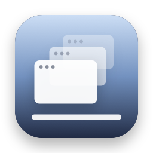
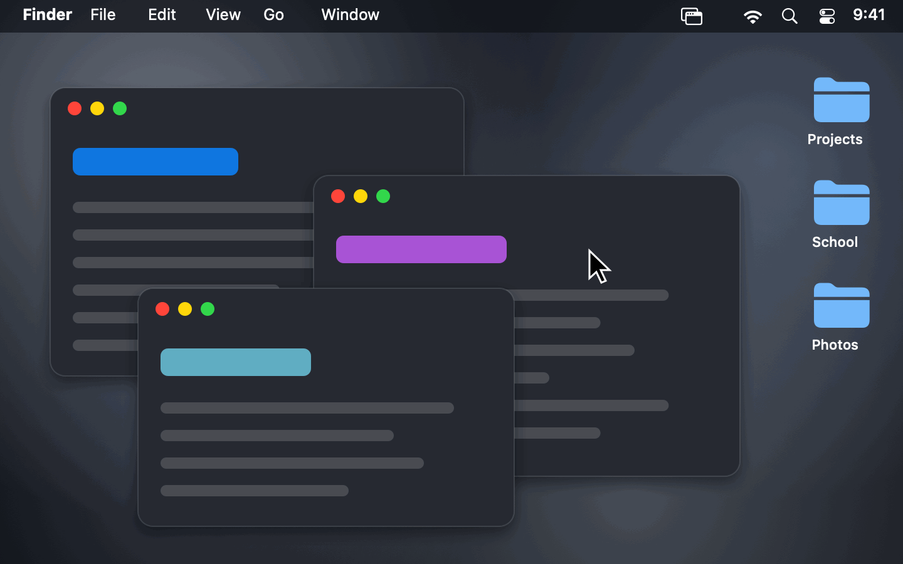

<p align="center">
  
</p>

<h1 align="center">Show Desktop for Mac</h1>

<p align="center">
  <b>Hide every window with one click. Bring them all back, exactly as they were, with another.</b><br>
  The Windows+D shortcut for macOS, in a free, open-source menu bar app.
</p>

<p align="center">
  <a href="https://github.com/stanczykwyatt/show-desktop/releases/latest/download/Show-Desktop.zip"><b>Download for Mac</b></a>
  &nbsp;·&nbsp;
  <a href="https://stanczykwyatt.github.io/show-desktop/">Website</a>
</p>

<p align="center">
  <a href="https://github.com/stanczykwyatt/show-desktop/actions/workflows/ci.yml"></a>
  <a href="https://github.com/stanczykwyatt/show-desktop/releases/latest"></a>
  
  
  
  <a href="LICENSE"></a>
</p>

<p align="center">
  
</p>

---

Need to grab a file off your Desktop, but it's buried under a dozen windows? Minimizing them one by one is a pain, and macOS's own Show Desktop shoves everything to the edges of the screen. Show Desktop clears the whole Desktop with one click on its menu bar icon, or with **⌃⇧D** from any app. Click again and every window comes back exactly where it was, with the app you were using back in front.

It's tiny, it has no internet access, and it's open source, so anyone can check what it does.

If Show Desktop saves you time, [starring the repo](https://github.com/stanczykwyatt/show-desktop/stargazers) helps other people find it.

## Features

- **One click to a clear Desktop.** Click the menu bar icon, or press **⌃⇧D** in any app, and every window is out of the way.
- **Puts everything back exactly as it was.** The second click brings back only the apps that were open, in the same order, with the one you were using on top. Apps you'd already hidden stay hidden.
- **Finder windows too.** Open Finder windows are minimized along with everything else and come back with them, so only your Desktop is showing.
- **Nothing is closed or quit.** Apps are hidden the same way as ⌘H, so nothing is lost, even if Show Desktop itself quits. Any app comes back from the Dock as usual.
- **Your choice of shortcut:** ⌃⇧D, ⌃⌥D or ⌃⌥⌘H, or none at all. Right-click the menu bar icon to change it.
- **Private by design.** No internet access, enforced by the macOS sandbox. No Accessibility or Screen Recording permission.
- **Free and open source.** No account, no subscription, no tracking, no dependencies.

## How it compares

| | Show Desktop | macOS Show Desktop (F11, gesture or hot corner) | Minimizing each window |
|---|:---:|:---:|:---:|
| One click from the menu bar | ✅ | — | — |
| Keyboard shortcut without the fn key | ✅ ⌃⇧D | Needs F11 or fn‑F11 | ⌘M, one window at a time |
| Windows fully out of the way | ✅ Hidden | Pushed to the screen edges | ✅ In the Dock |
| Brings back exactly what was open | ✅ | ✅ | One at a time |
| App you were using back in front | ✅ | ✅ | — |
| Already-hidden apps stay hidden | ✅ | ✅ | ✅ |

macOS's built-in Show Desktop works well if you're happy with F11 or a trackpad gesture. Show Desktop is for people who want a button they can see, a shortcut that works on any keyboard, and a Desktop that's actually clear while they use it.

## Install

1. [Download **Show-Desktop.zip**](https://github.com/stanczykwyatt/show-desktop/releases/latest/download/Show-Desktop.zip) and unzip it.
2. Move **Show Desktop** to your Applications folder and open it.
3. Click its icon in the menu bar, or press **⌃⇧D**. The first time, macOS asks whether Show Desktop can control Finder, which it uses to minimize Finder windows. You can say no and everything else still works.

Show Desktop opens at login from then on. Turn that off by right-clicking its icon.

> **About the security warning:** The first time you open Show Desktop, macOS may say Apple couldn't verify that it's free of malware. It shows up because Show Desktop isn't notarized yet: Apple charges developers $99 a year for that, and Show Desktop hasn't paid the fee. The code is fully open source, so you can read every line or build the app yourself. To open it, go to **System Settings → Privacy & Security** and click **Open Anyway**.

> **Can't see the icon?** On a MacBook with a camera notch, menu bar icons that don't fit are hidden behind it. Hold ⌘ and drag Show Desktop's icon to the right, or quit a menu bar app you don't need. The ⌃⇧D shortcut works either way.

### Build from source

You need macOS 14 or later and Swift 6, which comes with Xcode 16 or the Command Line Tools.

```bash
git clone https://github.com/stanczykwyatt/show-desktop.git
cd show-desktop
scripts/build-app.sh
open "build/Show Desktop.app"
```

## How to use it

| To | Do this |
|---|---|
| Show the Desktop | Click the menu bar icon, or press ⌃⇧D |
| Bring every window back | Click the icon again, or press ⌃⇧D again |
| Change or turn off the shortcut | Right-click the icon → Keyboard Shortcut |
| Leave Finder windows alone | Right-click the icon → turn off Also Minimize Finder Windows |
| Stop it opening at login | Right-click the icon → turn off Open at Login |

While the Desktop is showing, you can open files and folders, drag things around and even open other apps. The next click still brings back exactly what was open before.

## Privacy and security

Show Desktop is built so it *can't* misuse your data, not just so it promises not to.

- **No internet access.** The app runs in the macOS App Sandbox without a network entitlement, so it can't send anything anywhere. CI checks every build for this.
- **No access to your files.** It has no file entitlements at all, so the sandbox blocks it from opening any of your documents.
- **Can only talk to Finder.** Its one Apple Events entitlement is for Finder, used only to minimize and restore Finder windows, and macOS asks you first. Turn the option off and it never sends one.
- **Never sees what's in your windows.** It asks macOS which app owns each window, so it can restore them in order. Without Screen Recording permission, which it never asks for, macOS doesn't give it window titles or contents.
- **Never sees what you type.** The shortcut uses the Carbon hot key API, which only reports that one shortcut. No Accessibility or Input Monitoring permission is needed.
- **Saves nothing but its settings:** the shortcut you picked and whether to minimize Finder windows.
- **No dependencies.** Every line that runs is in this repository.

Check the app's permissions yourself with `codesign -d --entitlements - "/Applications/Show Desktop.app"`. The full details are in [SECURITY.md](SECURITY.md).

## FAQ

**How do I show the desktop on a Mac?**
Install Show Desktop and click its icon in the menu bar, or press ⌃⇧D. Every window is hidden and your Desktop is showing. Click again to bring everything back. macOS also has a built-in Show Desktop on F11 (fn‑F11 on most MacBooks), which pushes windows to the edges of the screen instead.

**What's the Mac equivalent of Windows+D?**
Show Desktop works like Windows+D: press ⌃⇧D to hide every window, and press it again to put them all back.

**How do I hide all windows on a Mac at once?**
⌥⌘H hides every app except the one in front. Show Desktop hides all of them, including the one in front and Finder's windows, with one click or ⌃⇧D, and remembers what to bring back.

**Does it close or quit my apps?**
No. Apps are hidden, the same as pressing ⌘H, and keep running with all their windows and unsaved work.

**What if I open another app while the Desktop is showing?**
That's fine. The next click brings back everything that was open before, and the app you opened stays open.

**Is it safe?**
Show Desktop can't connect to the internet, can't open your files and never sees your windows' contents or your keystrokes. The code is open source, so anyone can check.

**Does it work on Intel Macs?**
Yes. The download runs on Apple silicon and Intel Macs with macOS 14 Sonoma or later.

## More free Mac utilities

- **[Copy 2FA](https://github.com/stanczykwyatt/copy-2fa):** copy 2FA codes from Mail, Messages or a built-in authenticator with one keyboard shortcut. Also no internet access.

## Contributing

Contributions are welcome. See [CONTRIBUTING.md](CONTRIBUTING.md).

## License

Show Desktop is released under the [MIT License](LICENSE) and is provided as is, without warranty of any kind.

Show Desktop is an independent project. It isn't affiliated with, endorsed by or sponsored by Apple Inc. or Microsoft. Apple, Mac, macOS and Finder are trademarks of Apple Inc., registered in the U.S. and other countries. Windows is a trademark of Microsoft Corporation.
